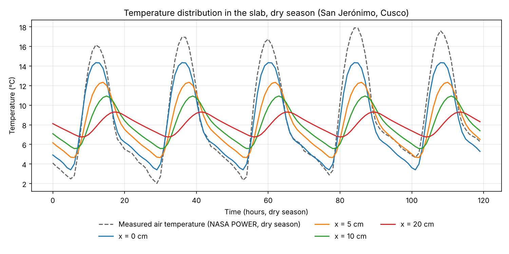

# pavimento-fourier-heladas-cusco

Fourier-series model of the thermal behaviour of rigid pavements under high-Andean frost in San Jerónimo, Cusco, Peru.

Hourly 2-m air temperature from NASA POWER (MERRA-2) is fitted with a five-harmonic Fourier series for the dry season (May–August). The fitted cycle is propagated into a 0.20 m concrete slab with the periodic solution of the 1D heat equation, and the resulting curling stress is estimated with Bradbury's coefficients.



## Contents

| File | Description |
|---|---|
| `analisis_real.py` | Full analysis: data loading, Fourier fit, temperature at depth, Bradbury curling stress, figure |
| `POWER_Point_Hourly_20240723_20260723_013d54S_071d88W_LST.csv` | Hourly T2M from NASA POWER, 23 Jul 2024 – 23 Jul 2026, local solar time (17,544 records) |
| `resultado_real_temperatura.png` | Figure produced by the script |
| `requirements.txt` | Python dependencies |

## How to reproduce

Requires Python 3.8 or newer.

```bash
pip install -r requirements.txt
python analisis_real.py
```

The script finds the NASA POWER file in its own folder, so it can be run from any directory. To use another NASA POWER hourly file:

```bash
python analisis_real.py path/to/POWER_Point_Hourly_....csv
```

No display is needed; the figure is saved as a PNG next to the script.

## Expected output

```
Hourly records loaded: 17544
Missing values interpolated: 72 (0.41%)
Dry-season hours (May-Aug): 5928

First-harmonic amplitude (dry season): 4.96 C
Fit RMSE: 1.615 C   |   R2: 0.847

Radius of relative stiffness l: 0.7523 m
L/l = 5.98  |  B/l = 4.79  |  C (Bradbury) = 0.916

Maximum thermal gradient (dry season): 6.66 C
E (AASHTO, from MR): 23477 MPa
Curling stress: 0.843 - 1.096 MPa (alpha_c between 1.0e-05 and 1.3e-05 1/C)

[Full record] Raw daily range: mean 10.87 C, max 17.37 C
[Full record] Absolute minimum temperature: -1.9 C
```

## Notes on the data

- The last 72 hourly values of the source file (21–23 July 2026) are flagged as missing (`-999`). The script fills them by linear interpolation; because they fall at the end of the record, this holds the last valid value constant. Removing those three days instead gives slightly different values: 5,856 dry-season hours, R² = 0.857, RMSE = 1.569 °C, maximum gradient 6.74 °C and curling stress 0.85–1.11 MPa.
- The MERRA-2 value is an average over a 0.5° × 0.625° grid cell with a mean elevation of 3,740 m, so it smooths valley-floor frost.

## Data acknowledgement

These data were obtained from the NASA Langley Research Center (LaRC) POWER Project funded through the NASA Earth Science/Applied Science Program.

## License

MIT, see `LICENSE`.
